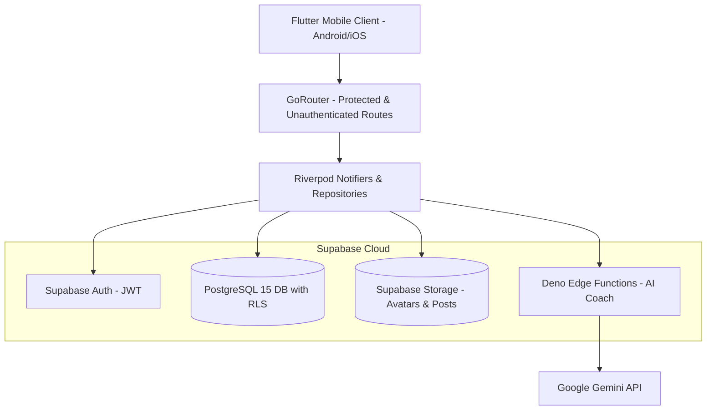
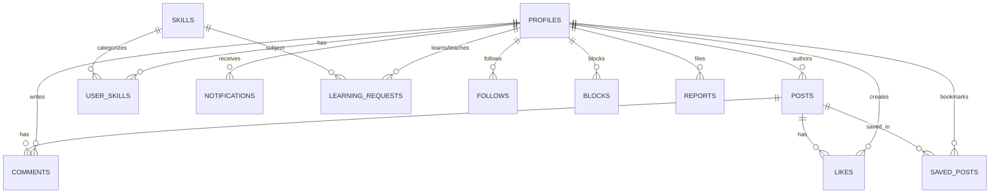

# UPMIND Architecture & Engineering Design

This document details the software architecture, data flow, entity relationships, and security model of **UPMIND**.

---

## 1. High-Level Architecture

---

## 2. Database Entity Relationships (ERD)

---

## 3. State Management & Data Flow (Riverpod)

The application adheres to clean architecture principles:
1. **Domain Layer**: Immutable data models (`ProfileModel`, `PostModel`, `SkillModel`, `LearningRequestModel`, `RoadmapModel`) with explicit JSON serialization and `copyWith` methods.
2. **Data Layer**: Repositories (`AuthRepository`, `PostRepository`, `ProfileRepository`, `LearningRepository`, `SkillRepository`, `NotificationRepository`, `DiscoverRepository`) encapsulating API and caching calls.
3. **Presentation Layer**: Riverpod `StateNotifierProvider` and `FutureProvider` orchestrating UI state, form validation, error handling, and loading spinners.

---

## 4. Security & Privacy Model

### Principle of Least Privilege
- **Row Level Security (RLS)** is enforced at the database level on all 12 tables.
- **Zero Secrets in Client**: The client binary contains only the public publishable anon key. All administrative operations and third-party AI keys reside exclusively in secured Supabase Edge Functions.
- **Block Protection**: Blocked users are filtered out of feeds, searches, profile views, and mutual learning requests.
- **Privacy Disclosures**: Users can delete their accounts directly in settings with complete database cascade purging.
